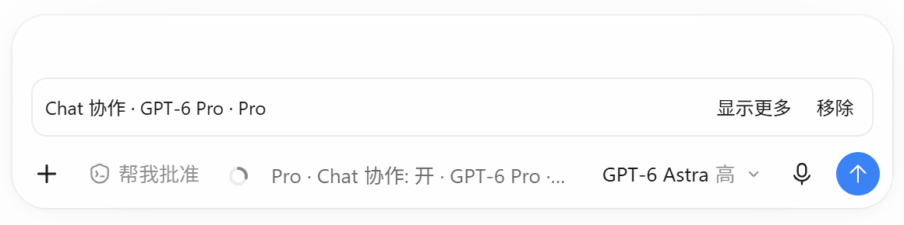

# Bridge

Version **0.2.0** uses a simpler single-session, plain-text exchange protocol and includes its matching Loader-managed skill. Update the renderer and bundled skill together; old command payloads are not compatible. See [release notes](docs/RELEASE-0.2.0.md).

**Chat advises. Codex does the work. Bridge carries the conversation.**

English · [简体中文](README.zh-CN.md)

Bridge is a Codex Script Loader plugin that connects the current Codex task to the Chat model you choose. Chat reviews plans and results; Codex checks the advice, works in your project, and reports evidence.

## Use Bridge

Requirements: Windows Codex desktop with Chat access, Codex Script Loader, and PowerShell 7.

1. Install the Bridge ZIP through Loader once.
2. In the Codex composer, choose a Chat model and enable Bridge for this task.
3. Describe the work normally. Codex checks Bridge's status, sends a short brief, and follows up with results in the same Chat.
4. Turn Bridge off for this task to stop new messages, or ask Codex to end the session.

Choose a model explicitly, including Pro. Existing tasks start disabled until you enable them. For a new task, create the task before enabling Bridge; an unsent draft does not grant a session.

A waiting result means Chat is still generating. Codex continues the same instance, session and request IDs; it does not send the message again. If a reply's output is lost, Codex reads the saved result by its original request ID. Reload changes the instance ID and prevents an old request from starting a duplicate generation.

## How it works

Bridge keeps one in-memory session per Loader instance. Loader supplies task identity and the fixed `status`, `exchange`, and `finish` commands. A native Chat adapter supplies the model catalog and sends or reads messages. Task preferences persist; prompts, replies and active sessions do not. Reloading the plugin ends the local session without replaying requests.

The Chat adapter uses Codex renderer services that do not have a stable third-party extension interface. If a future Codex update changes those services, Bridge reports a clear connection error; it does not switch models or resend uncertain messages.

For source-level design and state flow, see [the architecture note](docs/ARCHITECTURE.md). The bundled skill contains the Codex workflow. [Troubleshooting](docs/TROUBLESHOOTING.md) · [Usage guide](docs/USAGE.md) · [Report an issue](https://github.com/JHees/chatgpt-codex-bridge/issues)

## License

[MIT](LICENSE).
