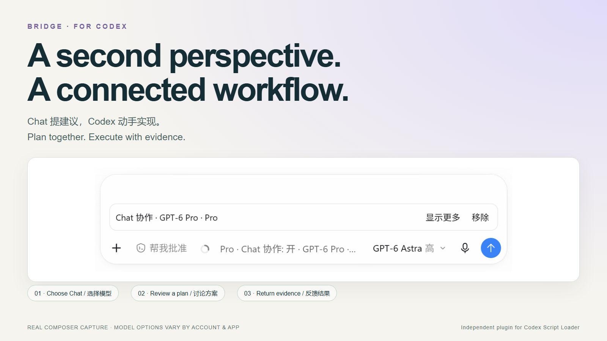
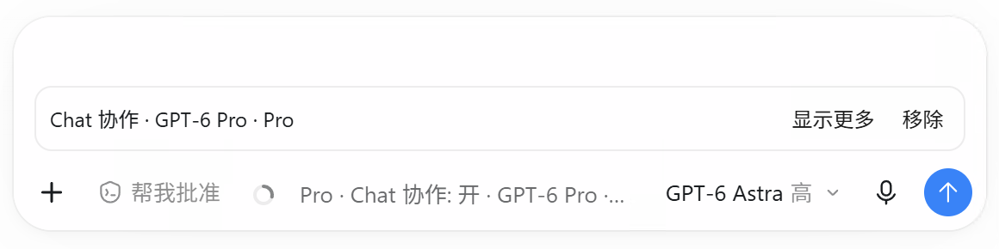
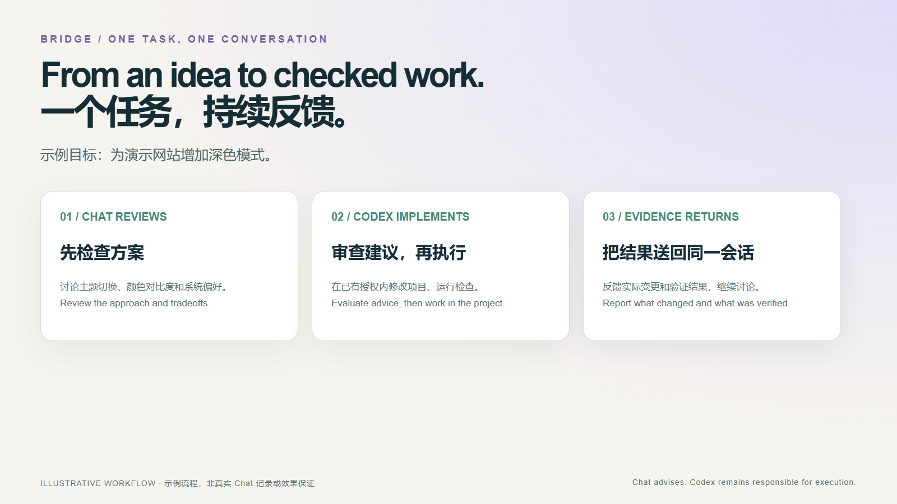
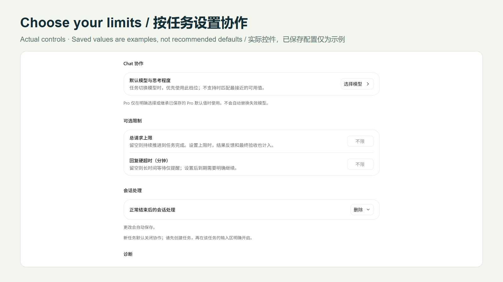

# Bridge

**Chat advises. Codex does the work. Bridge carries the conversation.**

**English** · [简体中文](README.zh-CN.md)



[Watch the ~9-second visual tour](docs/images/quick-tour.gif) · A slideshow of screenshots and illustrations, not a live recording.

[Download](https://github.com/JHees/chatgpt-codex-bridge/releases/latest) · [Install](#install) · [Contribute](CONTRIBUTING.md)

Bridge connects your current Codex task to the Chat model you choose. Chat reviews the plan; Codex evaluates the advice, works in your project, and returns evidence to the same conversation. Use it when you want a second perspective during implementation.

Current version: **0.2.1**, with a single-session, plain-text protocol. Update the complete plugin package. [Release notes](docs/RELEASE-0.2.1.md)

## Install

**Download the ZIP. No build step or separate skill installation is needed.** Requires Windows Codex desktop with Chat access, PowerShell 7, and a native Codex Script Loader that supports bundled skills.

1. Download the matching installer from the [latest Loader release](https://github.com/JHees/codex-script-loader/releases/latest): `windows-x64-setup.exe` for most PCs, or `windows-arm64-setup.exe` for Windows on Arm. Save your work and close Codex before the initial installation, then start it through the **Codex Script Loader** shortcut.
2. Under **Assets** in the [latest Bridge release](https://github.com/JHees/chatgpt-codex-bridge/releases/latest), download `bridge-<version>.zip`. Do not install GitHub's **Source code** archives. The `.sha256` file is for verification.
3. In **Codex Settings → Script-Loader**, install that ZIP through plugin management, review its permissions, and enable it. Keep the ZIP compressed. Loader manages the renderer plugin and bundled `bridge-chat` skill together.
4. Open **Bridge settings** and check the model catalog. If it is empty or shows `APP_UNSUPPORTED`, use **Diagnostics** and follow [troubleshooting](docs/TROUBLESHOOTING.md) before attempting collaboration.

Check for plugin updates in Loader; automatic updates are opt-in. Turn off collaboration for an individual task in its composer, or disable the whole plugin in Loader.

## 1. Choose Chat for the current task



Create the task first, then open **Chat collaboration**, explicitly choose an available model, and enable it. Existing tasks start disabled; an unsent draft cannot enable a session. Models in the screenshot are examples from that capture, not an availability guarantee. Pro requires explicit selection.

## 2. Describe the goal and follow the evidence



Example request: “Add a dark mode to the demo website. Ask Chat to review the plan, then have Codex implement it and report the test results.” The illustration explains the workflow; it is not a real conversation transcript or a guarantee of successful review. Codex evaluates Chat's advice under the task's existing permissions and confirmation rules.

`waiting` means Chat is still generating. Bridge reads the same request instead of sending it again. One Loader instance runs one Bridge session at a time.

## 3. Set optional limits and conversation handling



Set a total request cap, hard reply timeout, and whether to retain, archive or delete the Chat after completion. The screenshot shows one saved configuration, not recommended values or universal installation defaults. Choose what suits your work. Turning off a task stops new messages; you can also ask Codex to end the session.

## Compatibility and data

Bridge depends on internal Codex Chat services, which can change with app updates. Connection failures do not silently switch models or resend uncertain messages. Task preferences persist; Bridge does not persist prompts, replies or active sessions. The selected Chat's records are governed by Chat and your conversation-handling choice. Reloading ends the local session without replaying requests.

[Usage guide](docs/USAGE.md) · [Troubleshooting](docs/TROUBLESHOOTING.md) · [Architecture](docs/ARCHITECTURE.md) · [Report an issue](https://github.com/JHees/chatgpt-codex-bridge/issues)

## Development and contributions

Normal users should use the ZIP above. Development requires Node.js 22.12+ and PowerShell 7:

```powershell
git clone https://github.com/JHees/chatgpt-codex-bridge.git
cd chatgpt-codex-bridge
npm ci
npm run check
```

`check` runs type checking, lint, tests, build and packaging. Output: `dist/bridge-<version>.zip`. With dependencies installed, use `npm run build` followed by `npm run package` to rebuild the package only. Install the whole package through Loader; do not copy the skill separately.

Feedback, documentation and focused fixes are welcome. Start with the [contribution guide](CONTRIBUTING.md).

## License

[MIT](LICENSE). Not an official OpenAI project.
