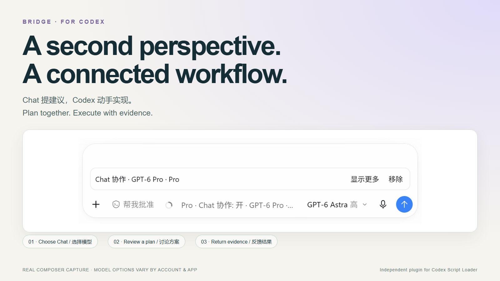
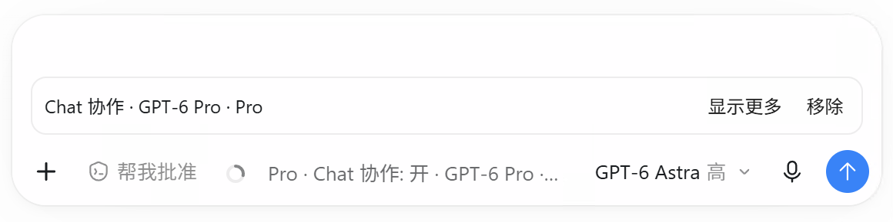
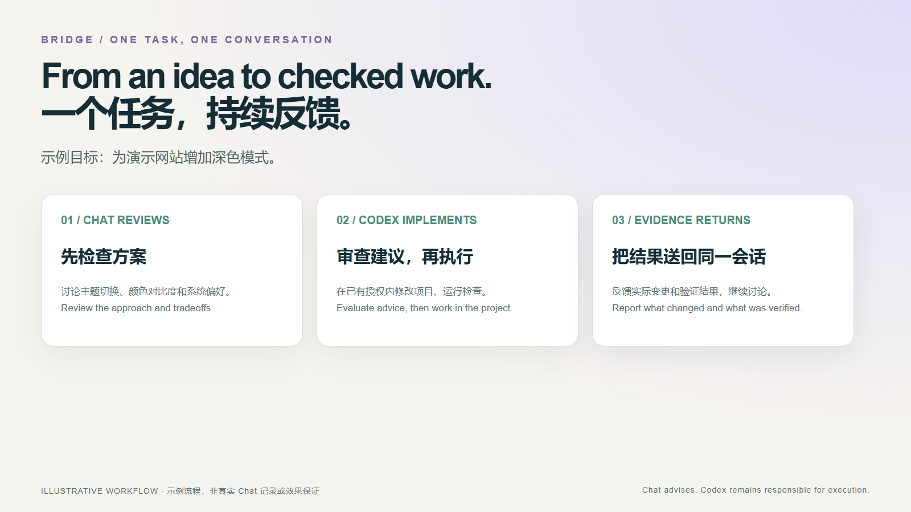
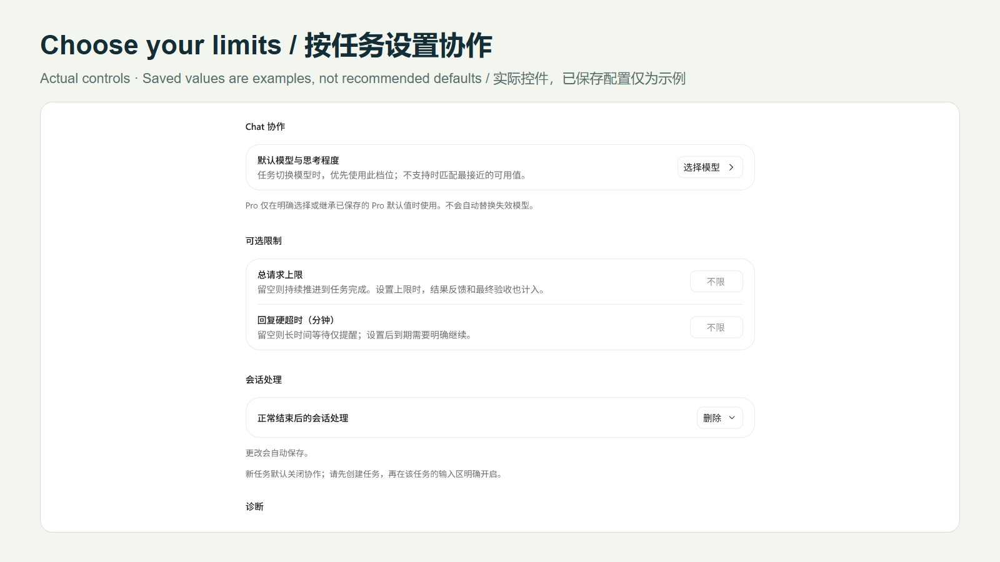

# Bridge

**Chat 提建议，Codex 动手实现，Bridge 负责传递进展。**

[English](README.md) · **简体中文**



[观看约 9 秒图文演示](docs/images/quick-tour.gif) · 截图与示意图轮播，非实时操作录像。

[下载安装包](https://github.com/JHees/chatgpt-codex-bridge/releases/latest) · [安装步骤](#安装) · [贡献指南](CONTRIBUTING.zh-CN.md)

Bridge 将当前 Codex 任务连接到你选择的 Chat 模型：让 Chat 评审方案，让 Codex 核对建议、修改项目，再把实际结果送回同一会话。适合希望在执行过程中获得第二轮意见的人。

当前版本 **0.2.3** 使用单会话、纯文本协议；升级时请整体更新插件包。[版本说明](docs/RELEASE-0.2.3.md)

## 安装

**直接下载 ZIP 即可，无需编译或单独安装 skill。** 需要 Windows Codex 桌面版、可用的 Chat、PowerShell 7，以及支持随包 skill 的原生 Codex Script Loader。

1. 从 [Loader 最新发布页](https://github.com/JHees/codex-script-loader/releases/latest) 下载对应架构的安装器：多数电脑选择 `windows-x64-setup.exe`，Windows on Arm 选择 `windows-arm64-setup.exe`。首次安装前保存工作并退出 Codex，随后通过 **Codex Script Loader** 快捷方式启动。
2. 在 [Bridge 最新发布页](https://github.com/JHees/chatgpt-codex-bridge/releases/latest) 的 **Assets** 中下载 `bridge-<版本>.zip`。不要下载 **Source code** 作为插件；`.sha256` 仅用于校验。
3. 在 **Codex 设置 → Script-Loader** 的插件管理中安装这个 ZIP，核对权限后启用。ZIP 无需解压；Loader 会统一管理插件和随包 `bridge-chat` skill。
4. 打开 **Bridge 设置**，检查模型目录。若显示 `APP_UNSUPPORTED` 或目录为空，点击“诊断”，按[故障排查](docs/TROUBLESHOOTING.md)处理；不要把空目录视为安装成功后即可协作。

更新时在 Loader 检查插件更新，自动更新为可选。关闭某个任务的协作使用输入区开关；停用整个插件使用 Loader 的禁用操作。

## 1. 在当前任务中选择 Chat



先创建任务，再打开输入区的 **Chat 协作** 控件，明确选择可用模型并开启。已有任务默认关闭；未发送的草稿不能启用协作。图中的模型为截图当时的示例，实际选项取决于账号和应用版本；Pro 需要明确选择。

## 2. 描述目标，查看建议与执行结果



示例目标：“为示例网站增加深色模式，请先让 Chat 检查方案，再由 Codex 实现并反馈测试结果。”这是一张流程说明图，不是实际会话记录，也不代表保证通过评审。Codex 审查 Chat 建议，并继续遵守当前任务的权限和确认要求。

`waiting` 表示 Chat 仍在生成；Bridge 读取同一请求的结果，不重复发送。一个 Loader 实例同一时间只运行一个 Bridge 会话。

## 3. 按需要设置限制与结束方式



可设置总请求上限、回复硬超时，以及结束后保留、归档或删除 Chat。截图展示的是一个已有设置示例，不代表推荐值或所有新安装的默认值；请按自己的需要选择。关闭任务开关会停止新消息，也可要求 Codex 结束协作。

## 兼容性与数据

Bridge 依赖 Codex 内部 Chat 服务，应用更新可能导致适配失效。出现连接错误时不会偷偷切换模型或重发状态不明的消息。任务偏好会保存；Bridge 不持久化提示词、回复和活动会话。所选 Chat 中的记录由 Chat 本身及你的会话处理选择决定。重载会结束本地会话，不会重放请求。

[使用指南](docs/USAGE.md) · [故障排查](docs/TROUBLESHOOTING.md) · [架构说明](docs/ARCHITECTURE.md) · [反馈问题](https://github.com/JHees/chatgpt-codex-bridge/issues)

## 开发与贡献

普通用户使用上面的 ZIP。开发需要 Node.js 22.12+ 和 PowerShell 7：

```powershell
git clone https://github.com/JHees/chatgpt-codex-bridge.git
cd chatgpt-codex-bridge
npm ci
npm run check
```

`check` 包含类型检查、lint、测试、构建和打包，输出 `dist/bridge-<版本>.zip`。已有依赖且只需重新打包时运行 `npm run build` 和 `npm run package`。始终通过 Loader 安装整个包，不单独复制 skill。

欢迎使用反馈、文档和小型修复。请先阅读[贡献指南](CONTRIBUTING.zh-CN.md)。

## 许可证

[MIT](LICENSE)。非 OpenAI 官方项目。
