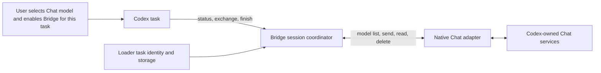
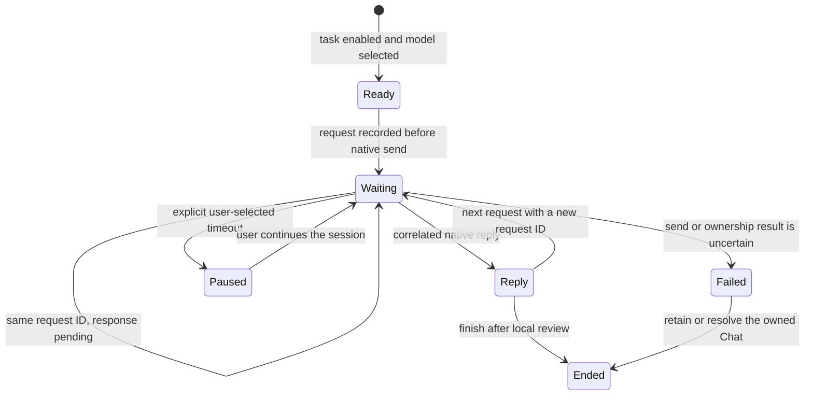

# Bridge architecture

Bridge joins the current Codex task to one native Chat conversation. Loader supplies task-scoped preferences, a task-bound composer control, and three commands. Bridge owns the conversation state. The selected Chat model and any request limits are frozen when the session starts.

## Responsibilities

- **Composer adapter:** displays the native Chat model catalog, per-task opt-in and active state. It writes a brief visible Bridge instruction into the task composer. The user's per-task opt-in authorizes Bridge; the instruction is context for Codex, not a hidden credential.
- **Session coordinator:** owns the single active task, frozen model settings, request IDs, pending turn, response and cleanup outcome. It handles the three commands and rejects a second payload for an existing request ID.
- **Native Chat adapter:** discovers the App's Chat services, starts one conversation, sends text, reads correlated replies and applies the selected cleanup policy. Internal App discovery stays in this adapter because Codex does not expose a stable plugin-level Chat API.
- **Loader helper and skill:** invoke the fixed host commands from Codex's existing PowerShell 7 process. The skill guides Codex through evidence gathering, review, execution and feedback; Bridge transports text and never interprets Chat's prose as tool permission.

## Request lifecycle

Every exchange carries the current runtime `instanceId`, task, request ID and plain text. The first exchange creates a session and returns its ID; later exchanges supply both IDs. Repeating an identical request reads its saved state and cannot create another Chat message. Changing the text for an existing ID is rejected. A bounded read returns `waiting`; it does not cancel or replay native generation. After reload, a new instance ID prevents an old request from starting duplicate generation. An uncertain native send stays unresolved until the same conversation can be checked or the user ends local Bridge collaboration; native generation may still complete.

Status reports protocol version 2 plus a per-runtime `instanceId`. An exchange must match that ID; a new instance rejects old requests, preventing accidental replay of a first request. New task cleanup defaults to retaining its Chat; explicitly saved policies on existing tasks are preserved. Only task preferences survive reload. Active sessions and replies remain in memory, so the plugin never reconstructs or replays work after restart. A new unsent draft cannot authorize a Bridge session; create the Codex task, then choose its model and enable Bridge.

## Trade-offs

Task opt-in is the authority. Bridge no longer depends on inspecting native composer text and inferring whether a particular hidden instruction was accepted. This removes the version-sensitive handshake; the visible task toggle still provides explicit user consent. The Chat adapter remains coupled to Codex's private renderer services. If those change, Bridge returns an adapter error and preserves any session whose send outcome is unknown.
